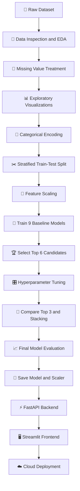
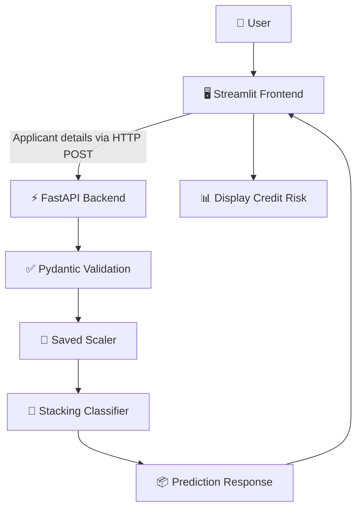

# 💳 Credit Risk Prediction


<p align="center">
  <strong>An End-to-End Machine Learning Application for Credit Risk Assessment</strong>
</p>

<p align="center">
  <a href="https://credit-risk-prediction04.streamlit.app/">
    
  </a>
  <a href="https://credit-risk-prediction-nkak.onrender.com">
    
  </a>
  <a href="https://github.com/ashutoshkashyap04/Credit-risk-prediction">
    
  </a>
</p>

<p align="center">
  
  
  
  
  
</p>


---

## 📌 Table of Contents

- [🌟 Project Overview](#-project-overview)
- [🎯 Problem Statement](#-problem-statement)
- [📊 Dataset Overview](#-dataset-overview)
- [🗂️ Project Structure](#️-project-structure)
- [🛠️ Tech Stack](#️-tech-stack)
- [⚙️ Machine Learning Workflow](#️-machine-learning-workflow)
- [📈 Model Performance](#-model-performance)
- [🔍 Final Model Evaluation](#-final-model-evaluation)
- [🏗️ Application Architecture](#️-application-architecture)
- [🚀 Live Deployment](#-live-deployment)
- [💻 Run Locally](#-run-locally)
- [🔌 API Usage](#-api-usage)
- [💡 Key Learnings](#-key-learnings)
- [🔮 Future Improvements](#-future-improvements)
- [👨‍💻 Author](#-author)

---

## 🌟 Project Overview

**Credit Risk Prediction** is an end-to-end machine learning project that classifies loan applicants into two categories:

- 🟢 **Good Credit (0):** Applicants belonging to the lower-risk class.
- 🔴 **Bad Credit (1):** Applicants belonging to the higher-risk class.

The project uses applicant information such as age, employment category, housing status, account balances, credit amount, loan duration, and loan purpose to predict credit risk.

Nine machine learning algorithms were compared, the strongest candidates were optimized using hyperparameter tuning, and a **Stacking Classifier** was selected as the final model.

The trained model was integrated into a FastAPI REST API and connected to an interactive Streamlit application. Both components are deployed online.

### ✨ Project Highlights

| Feature                      | Description                                                       |
| ---------------------------- | ----------------------------------------------------------------- |
| 📊 Exploratory Data Analysis | Missing-value analysis, feature distributions, and visualizations |
| 🧹 Data Preprocessing        | Missing-value handling, categorical encoding, and feature scaling |
| 🤖 Model Comparison          | Evaluation of nine classification algorithms                      |
| 🎛️ Hyperparameter Tuning    | RandomizedSearchCV with five-fold cross-validation                |
| 🧠 Ensemble Learning         | Stacking Classifier with Logistic Regression as the meta-model    |
| 📉 Model Evaluation          | Precision, recall, F1-score, ROC-AUC, and confusion matrix        |
| ⚡ Backend API                | FastAPI with Pydantic request validation                          |
| 🖥️ Interactive Frontend     | Streamlit application                                             |
| ☁️ Cloud Deployment          | Render and Streamlit Community Cloud                              |

---

## 🎯 Problem Statement

Credit risk assessment is an important part of lending because financial institutions must evaluate the possibility that applicants will fail to repay their loans.

A model that predicts most applicants as good credit may achieve reasonable accuracy while missing a significant proportion of risky applicants.

Therefore, this project focuses on evaluating multiple classification metrics rather than relying exclusively on accuracy.

The objective is to develop a machine learning application that predicts credit risk from applicant information and demonstrates the complete workflow from raw data exploration to cloud deployment.

---

## 📊 Dataset Overview

The project uses the **German Credit Risk Dataset**, containing 1,000 applicant records and 10 original columns.

### 📋 Dataset Statistics

| Property                     | Value                           |
| ---------------------------- | ------------------------------- |
| Total records                | 1,000                           |
| Original features            | 9                               |
| Target variable              | `Risk`                          |
| Training samples             | 800                             |
| Testing samples              | 200                             |
| Classification type          | Binary                          |
| Original target distribution | 70% good credit, 30% bad credit |

### 🎯 Target Distribution

| Class          | Encoded Value |   Records | Percentage |
| -------------- | ------------: | --------: | ---------: |
| 🟢 Good Credit |             0 |       700 |        70% |
| 🔴 Bad Credit  |             1 |       300 |        30% |
| **Total**      |             — | **1,000** |   **100%** |

The dataset is moderately imbalanced. Stratified splitting was used to maintain approximately the same class proportions in the training and testing sets.

### 🧾 Feature Description

| Feature            | Description                    |
| ------------------ | ------------------------------ |
| `Age`              | Age of the applicant           |
| `Sex`              | Applicant's recorded sex       |
| `Job`              | Encoded employment skill level |
| `Housing`          | Housing status                 |
| `Saving accounts`  | Savings account category       |
| `Checking account` | Checking account category      |
| `Credit amount`    | Amount of credit requested     |
| `Duration`         | Credit duration                |
| `Purpose`          | Purpose of the credit          |
| `Risk`             | Target variable                |

---

## 🗂️ Project Structure

```text
Credit-risk-prediction/
│
├── 📁 backend/
│   ├── app.py
│   └── schemas.py
│
├── 📁 data/
│   ├── 📁 raw/
│   │   └── cleaned_data.csv
│   └── 📁 processed/
│       ├── train.csv
│       └── test.csv
│
├── 📁 frontend/
│   └── main.py
│
├── 📁 models/
│   ├── stacking_classifier_model.pkl
│   └── scaler.pkl
│
├── 📁 notebooks/
│   ├── 01_data_loading_and_eda.ipynb
│   ├── 02_data_preprocessing.ipynb
│   └── 03_model_training_and_evaluation.ipynb
│
├── .gitignore
├── requirements.txt
└── README.md
```

> 📌 The structure above documents the workflow and expected artifacts.&#x20;

### 📓 Notebook Guide

| Notebook                                 | Purpose                                                                  |
| ---------------------------------------- | ------------------------------------------------------------------------ |
| `01_data_loading_and_eda.ipynb`          | Data inspection, missing-value treatment, validation, and visualizations |
| `02_data_preprocessing.ipynb`            | Categorical encoding, target encoding, and stratified splitting          |
| `03_model_training_and_evaluation.ipynb` | Baseline models, hyperparameter tuning, stacking, and evaluation         |

---

## 🛠️ Tech Stack


<p>
  
  
  
  
  
  
  
  
  
  
</p>


| Category              | Tools                             |
| --------------------- | --------------------------------- |
| Programming           | Python                            |
| Data analysis         | Pandas, NumPy                     |
| Visualization         | Matplotlib, Seaborn               |
| Machine learning      | Scikit-learn, XGBoost             |
| Preprocessing         | Pandas, StandardScaler            |
| Hyperparameter tuning | RandomizedSearchCV                |
| Ensemble learning     | StackingClassifier                |
| Model serialization   | Joblib                            |
| Backend               | FastAPI, Pydantic                 |
| Frontend              | Streamlit                         |
| Deployment            | Render, Streamlit Community Cloud |

---

## ⚙️ Machine Learning Workflow

The project follows a structured machine learning pipeline.



### 1️⃣ Data Loading and Exploratory Data Analysis

**Notebook:** `01_data_loading_and_eda.ipynb`

The first notebook focuses on understanding the dataset and improving its data quality.

#### Missing-value treatment

| Feature            | Missing Values |
| ------------------ | -------------: |
| `Saving accounts`  |            183 |
| `Checking account` |            394 |

Missing values were replaced with the category `No Account`, preserving all 1,000 records.

#### Employment category mapping

The original integer-coded `Job` feature was mapped to descriptive labels for visualization.

```python
job_mapping = {
    0: "Unskilled_Non-resident",
    1: "Unskilled_Resident",
    2: "Skilled",
    3: "Manager"
}
```

#### Data validation and visualization

The notebook also includes:

- Dataset dimensions, data types, and null-value checks.
- Checks for invalid negative values in age, credit amount, and duration.
- Count plots for categorical features.
- Distribution analysis of numerical features.
- Target class distribution analysis.

The cleaned dataset was saved to `data/raw/cleaned_data.csv`.

### 2️⃣ Data Preprocessing

**Notebook:** `02_data_preprocessing.ipynb`

#### One-hot encoding

The following features were one-hot encoded using `pandas.get_dummies()`:

- `Sex`
- `Housing`
- `Purpose`

#### Account category mapping

Savings account categories:

```python
saving_map = {
    "No Account": 0,
    "little": 1,
    "moderate": 2,
    "quite rich": 3,
    "rich": 4
}
```

Checking account categories:

```python
checking_map = {
    "No Account": 0,
    "little": 1,
    "moderate": 3,
    "rich": 4
}
```

These mappings encode the categories numerically and impose an ordering on them.

#### Target encoding

```text
bad  → 1
good → 0
```

#### Train-test split

An 80:20 stratified split was performed.

| Dataset      | Shape       |
| ------------ | ----------- |
| Training set | `(800, 17)` |
| Testing set  | `(200, 17)` |

The resulting datasets were saved to:

```text
data/processed/train.csv
data/processed/test.csv
```

### 3️⃣ Baseline Model Training

**Notebook:** `03_model_training_and_evaluation.ipynb`

Nine classification algorithms were trained and evaluated.

| No. | Algorithm              |
| --: | ---------------------- |
|   1 | Logistic Regression    |
|   2 | K-Nearest Neighbors    |
|   3 | Gaussian Naive Bayes   |
|   4 | Decision Tree          |
|   5 | Random Forest          |
|   6 | Support Vector Machine |
|   7 | AdaBoost               |
|   8 | Gradient Boosting      |
|   9 | XGBoost                |

#### Evaluation metrics

- 🎯 **Accuracy:** Overall proportion of correct predictions.
- 🔎 **Precision:** How many predicted bad-credit applicants actually belong to the bad-credit class.
- 🚨 **Recall:** How many actual bad-credit applicants were correctly identified.
- ⚖️ **F1-score:** Harmonic mean of precision and recall.
- 📈 **ROC-AUC:** Ability to distinguish the two classes across classification thresholds.

Because identifying bad-credit applicants is important, the F1-score was used to select promising candidates for further tuning.

#### Baseline results

| Model                | Accuracy | Precision | Recall | F1-score | ROC-AUC |
| -------------------- | -------: | --------: | -----: | -------: | ------: |
| XGBoost              |    0.760 |     0.620 |  0.517 |    0.564 |   0.759 |
| Decision Tree        |    0.720 |     0.534 |  0.517 |    0.525 |   0.662 |
| Random Forest        |    0.755 |     0.634 |  0.433 |    0.515 |   0.762 |
| Gradient Boosting    |    0.740 |     0.587 |  0.450 |    0.509 |   0.766 |
| Gaussian Naive Bayes |    0.665 |     0.439 |  0.417 |    0.427 |   0.654 |
| AdaBoost             |    0.720 |     0.556 |  0.333 |    0.417 |   0.769 |
| KNN                  |    0.700 |     0.500 |  0.283 |    0.362 |   0.664 |
| Logistic Regression  |    0.725 |     0.609 |  0.233 |    0.337 |   0.647 |
| SVM                  |    0.720 |     0.700 |  0.117 |    0.200 |   0.706 |

*Precision, recall, and F1-score refer to class 1 (bad credit).*

### 4️⃣ Hyperparameter Tuning

The six strongest baseline candidates were selected for optimization using `RandomizedSearchCV`.

**Configuration:**

- Cross-validation folds: 5
- Number of randomized parameter combinations: 20
- Scoring metric: F1-score
- Random state: 42

#### Best tuned candidates

| Model             | Best CV F1-score |
| ----------------- | ---------------: |
| Decision Tree     |           0.5442 |
| XGBoost           |           0.5436 |
| Gradient Boosting |           0.5042 |

These three models were carried forward to the final model comparison.

### 5️⃣ Stacking Classifier

The final ensemble combined three tuned base estimators:

- Decision Tree
- XGBoost
- Gradient Boosting

Logistic Regression was used as the final estimator to combine their predictions.

The Stacking Classifier was evaluated against each of the three tuned models.

| Model                   |  Accuracy | Precision | Recall | F1-score | ROC-AUC |
| ----------------------- | --------: | --------: | -----: | -------: | ------: |
| Gradient Boosting       |     0.775 |     0.636 |  0.583 |    0.609 |   0.765 |
| **Stacking Classifier** | **0.785** | **0.698** |  0.500 |    0.583 |   0.782 |
| XGBoost                 |     0.760 |     0.625 |  0.500 |    0.556 |   0.784 |
| Decision Tree           |     0.705 |     0.533 |  0.133 |    0.213 |   0.720 |

The Stacking Classifier was selected because it achieved the highest accuracy and precision among the final candidates, with a strong ROC-AUC score.

Gradient Boosting achieved better recall and F1-score, so the selected ensemble does not outperform every candidate on every metric.

### 6️⃣ Model Serialization

The trained model was saved using Joblib:

```python
import joblib

joblib.dump(
    stack_model,
    "../models/stacking_classifier_model.pkl"
)
```

The fitted `StandardScaler` was also saved as `models/scaler.pkl` for reuse during inference.

---

## 📈 Model Performance

### Final Test Results


<p align="center">
  
  
</p>

<p align="center">
  
  
  
</p>


| Metric                 | Final Score |
| ---------------------- | ----------: |
| Accuracy               |       78.5% |
| Precision — Bad Credit |       69.8% |
| Recall — Bad Credit    |       50.0% |
| F1-score — Bad Credit  |       58.3% |
| ROC-AUC                |       78.2% |

The final model correctly classified 157 out of 200 test applicants.

The recall of 50% means that the model identified 30 out of 60 actual bad-credit applicants. The remaining 30 were incorrectly classified as good credit.

This demonstrates why credit risk models must be evaluated using multiple metrics rather than accuracy alone.

---

## 🔍 Final Model Evaluation

### Confusion Matrix

```text
                 Predicted
                 Good   Bad
Actual Good       127    13
Actual Bad         30    30
```

| Outcome        | Count | Interpretation                                       |
| -------------- | ----: | ---------------------------------------------------- |
| True Negative  |   127 | Good-credit applicants correctly identified          |
| False Positive |    13 | Good-credit applicants incorrectly flagged as bad    |
| False Negative |    30 | Bad-credit applicants incorrectly classified as good |
| True Positive  |    30 | Bad-credit applicants correctly identified           |

### Classification Report

```text
              precision    recall  f1-score   support

           0       0.81      0.91      0.86       140
           1       0.70      0.50      0.58        60

    accuracy                           0.79       200
   macro avg       0.75      0.70      0.72       200
weighted avg       0.78      0.79      0.77       200
```

> ⚠️ **Important:** These results are based on a held-out test set of 200 applicants. They do not establish that the model is ready for real lending decisions. Independent validation, fairness assessment, and cost-sensitive threshold selection would be required before real-world use.

---

## 🏗️ Application Architecture

The application uses a decoupled frontend-backend architecture.



### ⚡ FastAPI Backend

The backend is implemented in `backend/app.py`, with request validation defined in `backend/schemas.py`.

Responsibilities include:

- Accepting applicant information through an API endpoint.
- Validating request fields using Pydantic.
- Preparing input features in the expected order.
- Applying the saved scaler.
- Generating a credit risk prediction.
- Returning the result as a JSON response.

### 🖥️ Streamlit Frontend

The frontend is implemented in `frontend/main.py`.

Responsibilities include:

- Collecting applicant information through an interactive interface.
- Sending input data to the FastAPI backend.
- Receiving the prediction response.
- Displaying the predicted credit risk.


---

## 🚀 Live Deployment

| Component            | Platform                  | Link                                                                           |
| -------------------- | ------------------------- | ------------------------------------------------------------------------------ |
| 🌐 Frontend          | Streamlit Community Cloud | [Open Application](https://credit-risk-prediction04.streamlit.app/)            |
| ⚡ Backend            | Render                    | [Open API Service](https://credit-risk-prediction-nkak.onrender.com)           |
| 📚 API Documentation | FastAPI Swagger UI        | [Open API Docs](https://credit-risk-prediction-nkak.onrender.com/docs)         |
| 💻 Source Code       | GitHub                    | [View Repository](https://github.com/ashutoshkashyap04/Credit-risk-prediction) |

The deployed frontend communicates with the backend through:

```text
https://credit-risk-prediction-nkak.onrender.com/predict
```

> 💡 Render's free services may take time to respond after periods of inactivity. The API documentation link may be unavailable if the service is sleeping or experiencing a deployment issue.

---

## 💻 Run Locally

### 1. Clone the repository

```bash
git clone https://github.com/ashutoshkashyap04/Credit-risk-prediction.git

cd Credit-risk-prediction
```

### 2. Create a virtual environment

```bash
python -m venv .venv
```

Activate it on Windows PowerShell:

```powershell
.\.venv\Scripts\Activate.ps1
```

Or Git Bash:

```bash
source .venv/Scripts/activate
```

### 3. Install dependencies

```bash
pip install -r requirements.txt
```

### 4. Start the FastAPI backend

From the project root:

```bash
uvicorn backend.app:app --host 0.0.0.0 --port 8000
```

The API should be available at:

- Base URL: `http://127.0.0.1:8000`
- Interactive documentation: `http://127.0.0.1:8000/docs`

### 5. Start the Streamlit frontend

Open another terminal, activate the virtual environment, and run:

```bash
streamlit run frontend/main.py
```

Make sure `frontend/main.py` points to the local API during local testing:

```python
API_URL = "http://127.0.0.1:8000/predict"
```

For the deployed application, configure it to use the Render endpoint instead.

**Note:** The model and scaler files must exist at the paths expected by the backend. If any datasets or model artifacts are excluded from Git, provide them separately before running the project.

---

## 🔌 API Usage

The backend exposes a prediction endpoint:

```http
POST /predict
```

### Example Request

```json
{
  "Age": 30,
  "Sex": "male",
  "Job": 2,
  "Housing": "own",
  "Saving_account": "moderate",
  "Checking_account": "moderate",
  "Credit_amount": 2000,
  "Duration": 12,
  "Purpose": "car"
}
```

The request field names must match the Pydantic schema in `backend/schemas.py`.

In particular, the account fields use underscores in the API request even though the original dataset contains spaces in their column names.

### Prediction Mapping

| Prediction | Result         |
| ---------- | -------------- |
| `0`        | 🟢 Good Credit |
| `1`        | 🔴 Bad Credit  |

The precise JSON response structure is defined by `backend/app.py`.

---

## 💡 Key Learnings

- 📊 Conducting exploratory data analysis on financial data.
- 🧹 Handling missing categorical information.
- 🔢 Encoding categorical features for machine learning.
- ✂️ Performing stratified train-test splitting.
- 📏 Applying feature scaling consistently during inference.
- 🤖 Comparing multiple classification algorithms.
- 🎛️ Optimizing model parameters using cross-validation.
- 🧠 Combining classifiers through stacking.
- 📈 Evaluating models using precision, recall, F1-score, ROC-AUC, and confusion matrices.
- 💾 Serializing trained models with Joblib.
- ⚡ Building REST APIs using FastAPI and Pydantic.
- 🔗 Integrating a frontend with a remote inference API.
- ☁️ Deploying a complete machine learning application to the cloud.

---

## 🔮 Future Improvements

### 📈 Model Improvements

- Increase recall for the bad-credit class.
- Optimize the decision threshold based on the relative costs of false positives and false negatives.
- Investigate alternative feature engineering and encoding approaches.
- Evaluate probability calibration and more robust cross-validation strategies.

### 🧪 Data and Validation

- Test on larger and more representative credit datasets.
- Conduct data quality and leakage checks.
- Evaluate model stability across applicant subgroups.
- Assess fairness and potential bias in predictions.

### ⚙️ Production Improvements

- Add automated tests for API validation and model inference.
- Implement structured logging and improved error handling.
- Monitor data drift and prediction quality.
- Add reproducible preprocessing pipelines and model versioning.

---

## 👨‍💻 Author

**Ashutosh Kashyap**

🎓 BS-MS in Artificial Intelligence & Cyber Security
🏛️ Indian Institute of Technology Patna


<p align="center">
  
  
</p>

<p align="center">
  
  
  
</p>


**Disclaimer:** This project is intended for educational and demonstration purposes. Its predictions should not be used as the sole basis for actual credit approval, rejection, or other consequential financial decisions.

